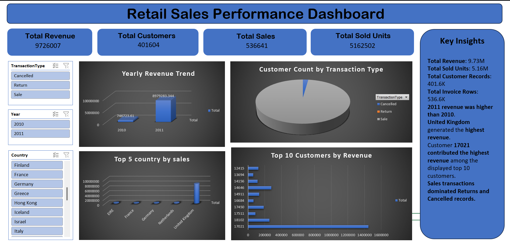

# 📊 Retail Sales Performance Dashboard (Excel)


An interactive, end-to-end **Excel dashboard** that turns 536K+ raw retail transaction rows into clear business insights on revenue, customers, countries and transaction behaviour. Built with **Pivot Tables, Pivot Charts, Slicers and KPI cards**.



---

## 📑 Table of Contents
- [Project Overview](#-project-overview)
- [Business Objectives](#-business-objectives)
- [Dataset](#-dataset)
- [Dashboard Features](#-dashboard-features)
- [Key Metrics](#-key-metrics)
- [Key Insights](#-key-insights)
- [Recommendations](#-recommendations)
- [Data Quality Notes](#-data-quality-notes)
- [Tools & Techniques](#-tools--techniques)
- [Repository Structure](#-repository-structure)
- [How to Use](#-how-to-use)
- [Author](#-author)

---

## 🎯 Project Overview
Retail teams need a fast way to see how the business is performing without digging through hundreds of thousands of rows. This project cleans the transaction data, models it with Pivot Tables, and presents the results in a single interactive dashboard where users can filter by **Transaction Type, Year and Country**.

## 🧩 Business Objectives
- Track overall **revenue, units sold, invoices and customer records** at a glance
- Understand **revenue trends** across the sales period
- Identify the **top-performing countries** and **highest-value customers**
- Measure the share of **Sale, Cancelled and Return** transactions
- Give business users a **self-service** dashboard using slicers

## 🗂 Dataset
| Item | Detail |
|---|---|
| File | `retail_dashboard.xlsx` (sheet: `retail_dashboard`) |
| Rows | 536,641 transaction lines |
| Period | 01 Dec 2010 to 09 Dec 2011 |
| Countries | 38 |
| Unique invoices | 25,900 |
| Unique customers | 4,372 (with a CustomerID) |
| Unique products (StockCode) | 4,070 |

**Columns:** `InvoiceNo`, `StockCode`, `Description`, `Quantity`, `InvoiceDate`, `InvoiceMonth`, `MonthNumber`, `Year`, `UnitPrice`, `SalesAmount`, `CustomerID`, `Country`, `IsCancelled`, `TransactionType`

**Workbook sheets:** `dashboard` (final view), `kpis`, `charts` and `Sheet2` (pivot tables), `Flipkart_sales` (cleaned data).

## ✨ Dashboard Features
- **4 KPI cards:** Total Revenue, Total Customers (records), Total Sales (invoice rows), Total Sold Units
- **Yearly Revenue Trend** chart
- **Customer Count by Transaction Type** (Sale / Cancelled / Return)
- **Top 5 Countries by Sales**
- **Top 10 Customers by Revenue**
- **Interactive slicers:** Transaction Type, Year, Country
- **Key Insights** panel for quick business takeaways

## 📈 Key Metrics
| Metric | Value |
|---|---|
| Total Revenue (net of cancellations) | **9,726,007** |
| Gross Sale Revenue | 10,619,987 |
| Cancelled Revenue | -893,980 |
| Total Units Sold (net) | **5,162,502** |
| Transaction Lines | 536,641 |
| Customer Records (rows with CustomerID) | 401,604 |

## 💡 Key Insights
1. **United Kingdom dominates.** It generates about **8.17M, roughly 84% of total revenue**. The next four countries (Netherlands, EIRE, Germany, France) each contribute only 0.2M to 0.28M.
2. **Strong growth into the end of 2011.** Monthly revenue rose from about 0.49M in April 2011 to **1.46M in November 2011**, the peak month. Sep to Nov 2011 show a clear seasonal rise.
3. **Sales dominate the transaction mix.** About 98% of lines are Sales, with about 1.7% Cancelled and 0.2% Returns.
4. **Cancellations cost revenue.** Cancelled orders remove about **0.89M (around 8%)** of gross sales revenue.
5. **Revenue is concentrated in a few customers.** The top customer (ID 14646) contributes about **279K**, followed by 18102 (256K) and 17450 (187K).
6. **Many records have no customer ID.** 135,037 lines (about 25%) carry no CustomerID, and they account for about **1.45M** of revenue, so customer-level analysis covers only part of the business.

## ✅ Recommendations
- **Reduce cancellations** by reviewing the top cancelled products and checking order and payment flow.
- **Plan inventory and marketing ahead of Sep to Nov**, the strongest sales window.
- **Retain high-value customers** with loyalty offers, account management and early access.
- **Grow outside the UK.** Netherlands, EIRE, Germany and France show potential for targeted campaigns.
- **Capture CustomerID at checkout** so more revenue can be tied to known customers.

## ⚠️ Data Quality Notes
- **2010 contains only December**, and 2011 ends on 9 Dec. Year-over-year comparison is therefore not like-for-like. Monthly trends are a better measure.
- **"Total Customers" (401,604)** counts rows that have a CustomerID, not distinct customers. Distinct customers = **4,372**.
- **"Total Sales" (536,641)** counts invoice lines, not distinct invoices. Distinct invoices = **25,900**.
- **Return** lines carry a unit price of 0, so they add units (negative) but **no revenue value**.
- Revenue is shown without a currency symbol because the source data does not specify one.

## 🛠 Tools & Techniques
- **Microsoft Excel:** Pivot Tables, Pivot Charts, Slicers
- **Data cleaning:** derived fields (`Year`, `InvoiceMonth`, `SalesAmount`, `IsCancelled`, `TransactionType`), handling of missing CustomerID and cancelled invoices (prefix `C`)
- **Dashboard design:** KPI cards, chart selection, dark chart theme, interactive filters
- **Business analysis:** revenue trend, customer segmentation, geographic analysis

## 📁 Repository Structure
```
retail-sales-dashboard-excel/
│
├── Flipkart_sales.xlsx        # Excel workbook with data, pivots and dashboard
├── Dashboard.png              # Dashboard screenshot
└── README.md
```

## ▶️ How to Use
1. Download or clone the repository:
```bash
   git clone https://github.com/Payal966-coder/retail-sales-dashboard-excel.git
```
2. Open `Flipkart_sales.xlsx` in **Microsoft Excel 2016 or later** (slicers need desktop Excel).
3. Go to the **`dashboard`** sheet.
4. Use the **Transaction Type, Year and Country** slicers to explore the data.
5. Press **Data > Refresh All** if you change the underlying data.

## 👤 Author
**Payal Saxena**
Marketing & Data Analyst

🔗 [LinkedIn](https://www.linkedin.com/in/payal-saxena-91332b289/) | 🐙 [GitHub](https://github.com/Payal966-coder)

---
⭐ If you found this project useful, please consider giving it a star.
